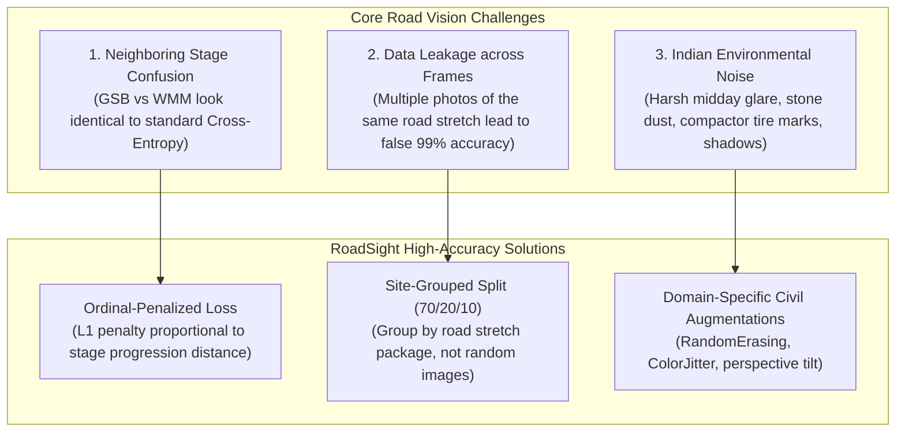

# RoadSight Model Training & Accuracy Optimization Guide
**A Civil Engineering & Deep Learning Blueprint for High-Precision Road Stage Classification**

---

## 1. Executive Strategy: Why Standard Models Fail & How We Fix It

Generic classification models (trained on ImageNet or COCO) achieve poor real-world accuracy on road construction sites due to three domain-specific challenges:



---

## 2. Dataset Preparation & Collection Playbook

### A. Target Volume per Class
Plan on **300 to 500 images per stage** across at least 3 distinct road construction packages:

| Stage Folder | IRC / MORTH Technical Name | Visual Characteristics | Key Differentiator |
|---|---|---|---|
| `0_earthwork` | Subgrade Excavation / Subgrade Prep | Red/brown natural soil, earth cutting, loose earth | Distinct earthy soil hues, lack of crushed gravel |
| `1_gsb` | Granular Sub-Base | Natural river gravel, coarse aggregate (up to 75mm) | Angular raw stone texture, lighter beige/gray aggregate |
| `2_wmm` | Wet Mix Macadam / WBM | Crushed stone aggregate with stone dust slurry | Dense, smooth compacted gray aggregate with vibratory roller ripple marks |
| `3_dbm` | Dense Bituminous Macadam | Black bitumen hot-mix binder layer | Dark charcoal/black color, rough porous binder texture |
| `4_bc_asphalt` | Bituminous Concrete (BC) | Final asphalt wearing course | Uniform pitch-black, tight dense surface, smooth rolling finish |
| `5_markings` | Finished Roadway | Thermoplastic retro-reflective stripes, kerbs | Painted white/yellow stripes, painted black/yellow kerbstones |

---

### B. Standard Folder Structure
Structure your collected images inside the project directory:

```text
ROAD site/
└── dataset/
    ├── train/
    │   ├── 0_earthwork/     (~350 images)
    │   ├── 1_gsb/           (~350 images)
    │   ├── 2_wmm/           (~350 images)
    │   ├── 3_dbm/           (~350 images)
    │   ├── 4_bc_asphalt/    (~350 images)
    │   └── 5_markings/      (~350 images)
    └── val/
        ├── 0_earthwork/     (~75 images from an unseen road package)
        ├── 1_gsb/           (~75 images)
        ├── 2_wmm/           (~75 images)
        ├── 3_dbm/           (~75 images)
        ├── 4_bc_asphalt/    (~75 images)
        └── 5_markings/      (~75 images)
```

> **CRITICAL RULE (Site-Grouped Validation):**  
> Never split images from the same road stretch randomly between `train` and `val`. If you take 50 photos on *Baner-Balewadi Road*, put **all of them in train** or **all of them in val**. Your validation set must test road sites the model has **never seen before**.

---

## 3. How to Train the Model

The training script [backend/train_model.py](file:///C:/Users/Ayush/OneDrive/Attachments/Desktop/ROAD%20site/backend/train_model.py) is pre-configured with:
- **Pretrained ConvNeXt-Tiny & EfficientNet-B0 backbones**
- **Ordinal Distance Penalized Loss**
- **Cosine Annealing Learning Rate Scheduler**
- **Model Checkpointing & Automatic ONNX Export**

### Option A: Run Locally on Your Computer
Open PowerShell in `C:\Users\Ayush\OneDrive\Attachments\Desktop\ROAD site`:

```powershell
# 1. Activate project directory
cd "C:\Users\Ayush\OneDrive\Attachments\Desktop\ROAD site"

# 2. Run training with ConvNeXt-Tiny (Recommended for best feature representation)
python backend/train_model.py --model convnext_tiny --epochs 25 --batch_size 16 --lr 0.0003

# Or run with lightweight EfficientNet-B0 (Fastest training on CPU/Laptop)
python backend/train_model.py --model efficientnet_b0 --epochs 20 --batch_size 8 --lr 0.0005
```

---

### Option B: Free GPU Acceleration via Google Colab / Kaggle
If you don't have a dedicated NVIDIA GPU on your laptop, use Google Colab's free T4 GPU:

1. Compress your `dataset/` folder into `dataset.zip`.
2. Open [Google Colab](https://colab.research.google.com/) and set runtime to **T4 GPU**.
3. Upload `dataset.zip` and `backend/train_model.py`.
4. Run:
```bash
!unzip -q dataset.zip -d ./
!python train_model.py --model convnext_tiny --epochs 30 --batch_size 32 --lr 0.0003
```
5. Download the resulting `best_road_stage_convnext_tiny.pth` file.

---

## 4. Four Techniques to Boost Model Accuracy Above 90%

### 1. Pretraining on Free Public Datasets
Before training on your own photos, pretrain the backbone on:
- **IDD-Lite (India Driving Dataset):** Exposes the model to unstructured Indian road conditions, mud, and uneven edges.
- **RDD2022 (Road Damage Dataset):** Teaches the convolutional filters to distinguish coarse aggregates from smooth asphalt.

### 2. Multi-Scale Training ($256\times256$ followed by $384\times384$)
Train the model in two progressive phases:
- **Phase 1 (Epochs 1–15):** Train at $256\times256$ image resolution to learn general color and composition.
- **Phase 2 (Epochs 16–25):** Fine-tune at $384\times384$ with a lower learning rate ($5\times 10^{-5}$) to capture fine gravel grain textures and binder pores.

### 3. Test-Time Augmentation (TTA)
During field inference in the mobile app or backend, run predictions on both the original image and a horizontally flipped image:
$$\hat{y} = \frac{1}{2} \left( f(I) + f(\text{flip}(I)) \right)$$
This reduces false alarms caused by localized shadows or parked machinery.

### 4. Bitemporal Consistency Enforcing
In road construction, stages **only progress forward** ($0 \rightarrow 1 \rightarrow 2 \rightarrow 3 \rightarrow 4 \rightarrow 5$).  
If yesterday's verified capture was **Stage 3 (DBM)**, today's image cannot physically be **Stage 1 (GSB)**.  
The backend incorporates a **monotonic progression constraint**: if a predicted stage is lower than the previously verified stage, it triggers an audit review flag rather than blindly accepting the classification.

---

## 5. Integrating Your Trained Model into RoadSight

Once your model has finished training, copy the saved checkpoint:
`models/best_road_stage_convnext_tiny.pth` (or `.onnx`)

In [backend/ml_engine.py](file:///C:/Users/Ayush/OneDrive/Attachments/Desktop/ROAD%20site/backend/ml_engine.py), update the weights path:

```python
# Load your fine-tuned weights
model = RoadStageClassifier(num_road_stages=6)
checkpoint = torch.load("./models/best_road_stage_convnext_tiny.pth", map_location=device)
model.load_state_dict(checkpoint["model_state_dict"])
model.eval()
```

Your fine-tuned model will now drive the real-time AI assessments in the mobile simulator and officer dashboard!
